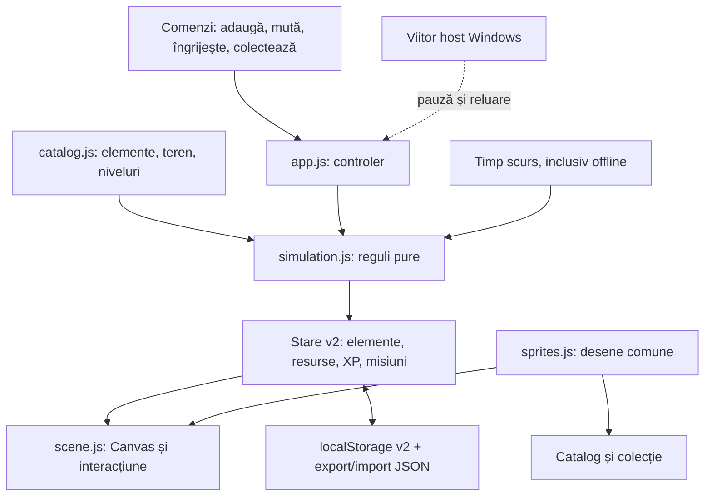

# Terraquarium — arhitectură și următorii pași

## Scop

O lume mică, liniștită, pe care o construiești și o lași să se dezvolte. Prima lume are plante și apă. Ținta desktop rămâne Windows; prototipul este verificat în browser înainte de integrarea nativă.

## Implementat în v0.2

Insulă izometrică cu 52 de locuri; 20 de elemente și desene distincte; construcție, mutare, reciclare, grilă și previzualizare; economie de frunze; producție pasivă; 6 niveluri și deblocări; 9 misiuni cu recompense unice; colecție; zi/noapte automat sau manual; vreme; denumire proprie; copii de siguranță și migrarea salvării v0.1.

## Reguli și echilibru

- Început: 140 de frunze, 62% umiditate, 7 elemente așezate, nivelul 1.
- Prețul se retrage numai după validarea nivelului, resurselor, terenului și ocupării locului. Fiecare amplasare reușită oferă XP și contribuie la misiuni.
- Mutarea este gratuită și nu schimbă creșterea sau experiența. Reciclarea întoarce 50% din prețul elementelor cumpărate, rotunjit în jos; elementele inițiale oferă 0.
- Producția/minut: veniturile elementelor, plus 0,2 pentru fiecare specie productivă distinctă, plus 1 de bază dacă există viață productivă. Cristalele și fântânile nu cresc indicatorul de specii.
- Producția și XP-ul pasiv se opresc când solul ajunge la 20% umiditate. Plantele nu mor. Umiditatea scade cu 6 puncte/oră pe senin, 3 în ceață și crește cu 12 în ploaie.
- Udarea adaugă 22 puncte și 3 XP, are pauză de 20 secunde și este indisponibilă la umiditate de cel puțin 95%.
- Creșterea este de 3 puncte/minut de sol umed; o plantă nouă pornește de la 12%. XP-ul pasiv este de 0,7/minut cât există specii și umiditate suficientă.
- Praguri cumulative pentru niveluri: 0, 35, 105, 220, 390 și 650 XP. Coșul are capacitatea `100 + 40 × nivel`. Frunzele suplimentare nu se acumulează cât coșul este plin.
- Colectarea transferă frunzele întregi și păstrează fracția; oferă 0,4 XP/frunză. Recompensele misiunilor pot fi primite o singură dată.
- La revenire se simulează cel mult 8 ore. Schimbarea ceasului înapoi nu generează progres suplimentar.

Sunt reguli de joc, nu o simulare biologică. Iazul are teren acvatic și elemente animate, dar nu simulăm încă nivelul apei, nutrienții sau relațiile dintre specii.

## Salvare și limite între componente

`terraquarium.world.v2` păstrează resurse, obiecte cu ID unic, poziții, creștere, timestamp, XP, misiuni primite, colecție, numele insulei și preferințe. Importul validează versiunea, terenul, intervalele numerice și coliziunile. Versiunile necunoscute sunt refuzate la import; o salvare locală coruptă este recuperată din v1 dacă există, altfel se creează o lume validă.

v1 este citită și migrată fără ștergerea cheii originale. O migrare păstrează umiditatea, creșterea stejarului, lumina și preferința de animație. Taburile aceleiași origini primesc modificările prin evenimentele de stocare. Pentru mutarea între origini sau calculatoare se folosesc exportul/importul.

Motorul de simulare nu depinde de DOM, Canvas sau Windows. Randarea consumă starea, folosește aceleași sprite-uri ca galeria și este limitată la 30 FPS. Pagina ascunsă sau callbackul de pauză al hostului opresc randarea. Preferința de mișcare redusă și pauza animației păstrează scena statică și comenzile utilizabile.

## Urmează: desktop Windows

1. Testarea Lively Wallpaper ca host pentru pagina locală `?ambient=1`; alegerea playerului și verificarea comportamentului real în spatele iconițelor.
2. Comenzi accesibile din host sau dintr-un panou separat, fără să încurce operarea desktopului.
3. Verificarea persistenței după restartul hostului. Nu presupunem că stocarea browserului va fi păstrată identic în fiecare player. Exportul/importul este deja disponibil.
4. Activarea notificărilor de pauză ale hostului și verificarea adaptorului `livelyWallpaperPlaybackChanged` în integrarea reală.
5. Teste pentru 1080p, 1440p, scalare Windows, două monitoare, aplicații fullscreen și Explorer repornit; măsurători CPU/GPU/RAM.
6. Dacă hostul nu permite interacțiunea/persistența necesară, alegem un host Windows propriu pe baza rezultatelor. Regulile și scena rămân reutilizabile.

Referințe pentru investigația hostului: [Web Player](https://github.com/lively-community/lively/wiki/Web-Player), [Interaction](https://github.com/lively-community/lively/wiki/Web-Guide-IV-:-Interaction), [System Data](https://github.com/lively-community/lively/wiki/Web-Guide-V-:-System-Data).

## După validarea jocului și a hostului

Extindere de teren, anotimpuri, relații simple între plante și viețuitoare, jurnal de evenimente, mai multe forme ale insulei și alte ecosisteme. Catalogul și terenul sunt separate pentru a facilita extinderea; nu există încă lumi suplimentare, multiplayer, instalator sau pornire automată cu Windows.
