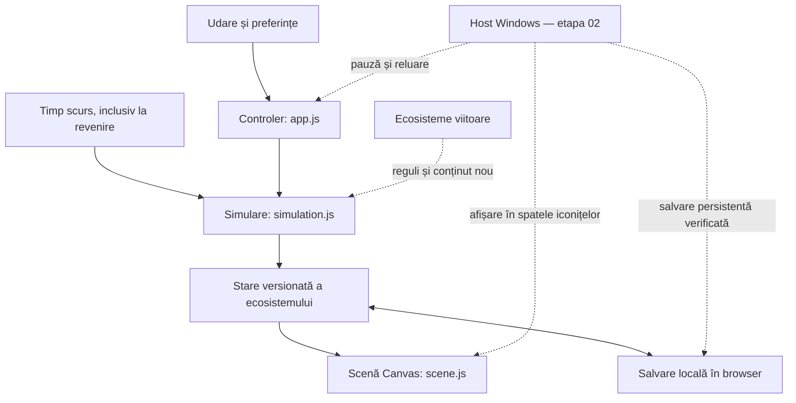

# Terraquarium — schema de pregătire

## Ideea

Un mic ecosistem liniștit pe fundalul desktopului: îl privești, îl îngrijești ocazional, iar acesta se dezvoltă fără sesiuni lungi. Prima lume are plante și apă. Ulterior putem construi un acvariu, un terariu de pădure sau un deșert.

Ținta inițială este Windows, pornind de la calculatorul pe care dezvoltăm. Platformele suplimentare se decid după ce funcționează primul wallpaper. Stilul vizual provizoriu este pixel art; toate elementele sunt desenate local, fără resurse externe.

## Schema tehnică

Motorul de simulare nu cunoaște Canvas, browserul sau Windows. Scena citește starea și o desenează. Controlerul le conectează și gestionează salvarea. Integrarea desktop trebuie să rămână un adaptor, astfel încât jocul să poată fi verificat și într-un browser obișnuit.

## 01. Primul răsad — implementat

- O insulă cu un iaz decorativ, vegetație și o plantă principală.
- Umiditate între 0–100 și creștere între 0–100.
- Udare +18; consum 6/oră; creștere +12/oră numai cât umiditatea este peste 20.
- Revenire offline cu maximum opt ore simulate; fără moarte sau pierderea creșterii.
- Salvare `terraquarium.world.v1` cu `version`, `ecosystem`, progres, timestamp și preferințe validate.
- Zi/noapte manual, mișcare redusă, ambient și oprirea desenării când pagina este ascunsă.

Criteriu: pornește local, udarea modifică starea, reîncărcarea o păstrează, scena reflectă creșterea și interfața încape pe desktop/mobil.

## 02. Pe desktop — următoarea etapă

Prima opțiune de investigat este **Lively Wallpaper**, care acceptă pagini web și permite integrarea comenzilor. Folosim proiectul web existent, fără să construim imediat un launcher nativ propriu. Aceasta este o decizie de pregătire; Lively nu este instalat sau configurat de prototip.

Pași:

1. Verificarea instalării Lively și a playerului disponibil, apoi importul paginii servite local, cu `?ambient=1`.
2. Confirmarea că scena apare în spatele iconițelor și că interacțiunea nu interferează cu fișierele de pe desktop. O fereastră fullscreen sau transparentă nu este criteriu suficient.
3. Stabilirea comenzilor de îngrijire prin meniul Lively Properties sau un mic panou dedicat, astfel încât să nu depindem de tastatura capturată de wallpaper.
4. Activarea notificărilor de pauză în configurația pachetului Lively și verificarea callbackului `livelyWallpaperPlaybackChanged`, deja delimitat în `app.js`. Nu există încă un pachet Lively în acest repo.
5. Verificarea păstrării progresului după închiderea/restartul hostului. Nu presupunem că salvarea browserului va fi persistentă în orice player/configurație. Adăugăm export/import sau salvare pe disc înainte de a declara desktopul gata.
6. Test pe 1080p și 1440p, scalare Windows, două monitoare, fullscreen peste wallpaper și Explorer repornit.
7. Măsurarea CPU, GPU și RAM: bugetul inițial de proiect este maximum 30 FPS activ și fără desenări în pauză. Consumul numeric se fixează după măsurători pe calculatorul țintă.

Fallback: dacă hostul nu oferă interacțiunea și persistența necesare, evaluăm un host Windows propriu. Alegerea Electron/Tauri/.NET se face atunci, pe baza testelor și a costului integrării, fără a schimba regulile ecosistemului.

Criteriu: wallpaper real, comenzi utilizabile, progres păstrat după restart, pauză funcțională și consum măsurat. Abia apoi marcăm integrarea Windows drept completă.

Surse oficiale consultate pentru această etapă:

- [Lively — Web Player](https://github.com/lively-community/lively/wiki/Web-Player): player web și diferențe privind stocarea.
- [Lively — Interaction](https://github.com/lively-community/lively/wiki/Web-Guide-IV-:-Interaction): input și meniul Lively Properties.
- [Lively — System Data](https://github.com/lively-community/lively/wiki/Web-Guide-V-:-System-Data): notificări `--pause-event true` și starea `IsPaused`.

## 03. Un ecosistem mai viu

Mai multe plante și plantare pe insulă; ceas zi/noapte real cu opțiune manuală; apă cu o regulă simplă de evaporare/refacere; prima viețuitoare; un mic jurnal al schimbărilor. Adăugăm câte o mecanică și o verificăm înainte de următoarea.

Criteriu: o buclă clară „privește → îngrijește → observă schimbarea”, fără nevoia de a da clic constant și fără pedepse pentru absență.

## 04. Alte ecosisteme

Extragem parametrii într-un catalog de ecosisteme (`pond`, `aquarium`, `forest`, `desert`). Separăm definițiile plantelor/viețuitoarelor de simulare și desen. Migrăm formatul de salvare explicit dacă schema se schimbă.

Nu implementăm acum catalogul, inventarul sau un sistem de pluginuri: mai întâi validăm lumea cu plante și apă.

## Limitele primei versiuni

Fără conturi, multiplayer, magazin, instalator, pornire automată cu Windows, audio sau instalare automată de software. Acestea nu sunt necesare pentru validarea începutului. Prima versiune este locală; repository-ul GitHub conține sursa, nu găzduiește implicit jocul.
